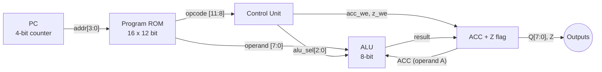

<h1 align="center">Mini 8-bit Accumulator CPU in VHDL</h1>

<p align="center">
  
  
  
  
</p>

<p align="center">
  CSE 450 (VLSI Lab) &ndash; Final Project, Spring 2026<br>
  Department of Computer Science and Engineering, University of Asia Pacific
</p>

<p align="center"><b>Nazmul Mridha</b> &nbsp;|&nbsp; ID: <b>22201161</b></p>

---

## Table of contents
1. [Overview](#1-overview)
2. [Instruction set](#2-instruction-set)
3. [Architecture](#3-architecture)
4. [Repository structure](#4-repository-structure)
5. [Module details and RTL schematics](#5-module-details-and-rtl-schematics)
6. [Test program and expected results](#6-test-program-and-expected-results)
7. [Simulation waveforms](#7-simulation-waveforms)
8. [How to run](#8-how-to-run)
9. [Challenges](#9-challenges)
10. [Author](#10-author)

---

## 1. Overview
This project implements a small **single-cycle 8-bit accumulator CPU** in VHDL.
Fetch, decode and execute all happen in one clock cycle; the result is written to the
accumulator on the rising edge of the clock.

**Key features**
- 5 instructions: `LDI`, `ADD` (mandatory) and `SUB`, `AND`, `OR` (assigned for ID ending in **1** = *Set 1*)
- 4-bit program counter, 16 x 12-bit program ROM
- 8-bit accumulator (`ACC`, also the output `Q[7:0]`) and 1-bit zero flag `Z`
- Synchronous, active-high `RESET` (PC = 0, ACC = 0x00, Z = 1)
- Unused opcodes (including `0000`) behave as **NOP**
- Modular design with a self-checking testbench for **every** module

<p align="center">
  <br>
  <i>Top-level CPU: inputs <code>clk</code>, <code>reset</code>; outputs <code>q[7:0]</code>, <code>z</code>, <code>pc_o[3:0]</code></i>
</p>

## 2. Instruction set
Each instruction is 12 bits: `instr[11:8]` = opcode, `instr[7:0]` = 8-bit immediate operand.

| Mnemonic | Opcode | Operation | Z flag | Type |
|---|---|---|---|---|
| `LDI imm` | `0001` | `ACC <- imm` | updated | mandatory |
| `ADD imm` | `0010` | `ACC <- ACC + imm` (carry discarded) | updated | mandatory |
| `SUB imm` | `0011` | `ACC <- ACC - imm` (mod 256) | updated | **assigned** |
| `AND imm` | `0100` | `ACC <- ACC AND imm` | updated | **assigned** |
| `OR imm`  | `0101` | `ACC <- ACC OR imm` | updated | **assigned** |
| any other | - | NOP: PC <- PC + 1, nothing else changes | unchanged | - |

Example: `LDI 0x3C` = `0001 00111100` = `0x13C`.

## 3. Architecture


ALU function select (`alu_sel`) produced by the control unit:

| alu_sel | Instruction | Result |
|---|---|---|
| `000` | LDI | operand |
| `001` | ADD | ACC + operand |
| `010` | SUB | ACC - operand |
| `011` | AND | ACC and operand |
| `100` | OR | ACC or operand |

Internal RTL schematic of the complete CPU (generated by Xilinx ISE):

<p align="center">
  
</p>

## 4. Repository structure
```text
8bit-accumulator-cpu-vhdl/
├── src/
│   ├── pc.vhd          # 4-bit program counter
│   ├── rom.vhd         # program ROM (Set 1 test program)
│   ├── control.vhd     # control unit / opcode decoder
│   ├── alu.vhd         # ALU: LDI, ADD, SUB, AND, OR
│   ├── acc_z.vhd       # ACC register + Z flag
│   └── cpu.vhd         # top-level CPU
├── tb/
│   ├── pc_tb.vhd
│   ├── rom_tb.vhd
│   ├── control_tb.vhd
│   ├── alu_tb.vhd
│   ├── acc_z_tb.vhd
│   └── cpu_tb.vhd      # full-CPU test of the Appendix B program
├── docs/
│   ├── images/         # RTL schematics and waveforms used in this README
│   └── CSE450_Final_Report_22201161.pdf
└── README.md
```

## 5. Module details and RTL schematics
For each module: top view (left) and expanded RTL view (right), generated by Xilinx ISE (XST).

### 5.1 Program counter - `pc.vhd`
4-bit counter, `PC <- PC + 1` every clock, cleared by synchronous reset. Set 1 has no `JZ`, so no jump logic is needed. Synthesised as a 4-bit adder feeding an `FDR` flip-flop.

<p align="center">
  
  &nbsp;&nbsp;
  
</p>

### 5.2 Program ROM - `rom.vhd`
16 x 12-bit constant array, read combinationally with PC. Inferred as a read-only memory block (`Mram_instr1`).

| Addr | Instruction | Machine code |
|---|---|---|
| 0 | `LDI 0x3C` | `0x13C` |
| 1 | `ADD 0x0F` | `0x20F` |
| 2 | `SUB 0x0B` | `0x30B` |
| 3 | `AND 0xF0` | `0x4F0` |
| 4 | `OR 0x0A`  | `0x50A` |
| 5 | `SUB 0x4A` | `0x34A` |
| 6 | `SUB 0x01` | `0x301` |
| 7-15 | NOP | `0x000` |

<p align="center">
  
  &nbsp;&nbsp;
  
</p>

### 5.3 Control unit - `control.vhd`
Decodes the 4-bit opcode into `alu_sel`, `acc_we` and `z_we`. All outputs default to NOP, so unused opcodes leave ACC and Z unchanged.

| Opcode | Instr | alu_sel | acc_we | z_we |
|---|---|---|---|---|
| `0001` | LDI | `000` | 1 | 1 |
| `0010` | ADD | `001` | 1 | 1 |
| `0011` | SUB | `010` | 1 | 1 |
| `0100` | AND | `011` | 1 | 1 |
| `0101` | OR  | `100` | 1 | 1 |
| others | NOP | `000` | 0 | 0 |

<p align="center">
  
  &nbsp;&nbsp;
  
</p>

### 5.4 ALU - `alu.vhd`
Combinational 8-bit ALU. ADD and SUB use unsigned arithmetic, so carry/borrow is discarded and results wrap modulo 256 (e.g. `0x00 - 0x01 = 0xFF`).

<p align="center">
  
  &nbsp;&nbsp;
  
</p>

### 5.5 ACC and Z registers - `acc_z.vhd`
`ACC` loads the ALU result when `acc_we = 1`; `Z` is set when the loaded value is `0x00` (when `z_we = 1`). Reset gives ACC = `0x00`, Z = `1`. Synthesised as eight `FDRE` flip-flops, an 8-input NOR gate and one `FDSE` flip-flop for Z.

<p align="center">
  
  &nbsp;&nbsp;
  
</p>

## 6. Test program and expected results
Appendix B test program for Set 1. Values are shown after each rising clock edge.

| Cycle | PC | Instruction | ACC (hex) | Z | ACC (binary) | Next PC |
|---|---|---|---|---|---|---|
| 0 | - | `RESET = 1` | `0x00` | 1 | `00000000` | 0 |
| 1 | 0 | `LDI 0x3C` | `0x3C` | 0 | `00111100` | 1 |
| 2 | 1 | `ADD 0x0F` | `0x4B` | 0 | `01001011` | 2 |
| 3 | 2 | `SUB 0x0B` | `0x40` | 0 | `01000000` | 3 |
| 4 | 3 | `AND 0xF0` | `0x40` | 0 | `01000000` | 4 |
| 5 | 4 | `OR 0x0A`  | `0x4A` | 0 | `01001010` | 5 |
| 6 | 5 | `SUB 0x4A` | `0x00` | 1 | `00000000` | 6 |
| 7 | 6 | `SUB 0x01` | `0xFF` | 0 | `11111111` | 7 |

The simulated ACC, Z and PC match this table in every cycle.

## 7. Simulation waveforms

### Full CPU - `cpu_tb.vhd`
<p align="center">
  
</p>

- `reset` is high only for the first rising edge, then the CPU runs one instruction per clock.
- `q` goes `00` -> `3C` -> `4B` -> `40` -> `40` -> `4A` -> `00` -> `FF`.
- `z` is `1` after reset, `0` after `LDI`, `1` for one cycle after `SUB 0x4A`, then `0` again.
- `pc_o` counts `0000` to `0111`; `done` becomes `TRUE` and stops the clock.

### Module testbenches
| Module | Waveform |
|---|---|
| PC (`pc_tb`) |  |
| ROM (`rom_tb`) |  |
| Control (`control_tb`) |  |
| ALU (`alu_tb`) |  |
| ACC/Z (`acc_z_tb`) |  |

## 8. How to run

### Xilinx ISE (used for this project)
1. Create a new project and add every file from `src/` and `tb/`.
2. Set `cpu_tb` as the top module in the **Simulation** view.
3. Run **Simulate Behavioral Model (ISim)**. Check the console for `ALL TESTS PASSED` and make sure no `MISMATCH` messages appear.
4. For the RTL schematics, select a module in the **Implementation** view and run *Synthesize - XST -> View RTL Schematic*.

> ISE supports VHDL-93, so the code does not use VHDL-2008 functions such as `to_hstring`.

### GHDL (optional, command line)
```bash
ghdl -a --std=93 src/pc.vhd src/rom.vhd src/control.vhd src/alu.vhd src/acc_z.vhd src/cpu.vhd tb/cpu_tb.vhd
ghdl -e --std=93 cpu_tb
ghdl -r --std=93 cpu_tb --wave=cpu_tb.ghw     # open cpu_tb.ghw in GTKWave
```
Replace `cpu_tb` and the testbench file with e.g. `alu_tb` / `tb/alu_tb.vhd` to run a single module test.

## 9. Challenges
- Encoding the 12-bit instructions correctly (e.g. `SUB 0x4A` = `0x34A`).
- Making `SUB` and `ADD` wrap modulo 256 with unsigned arithmetic.
- Updating `Z` only when ACC is written, so NOP leaves ACC and Z unchanged.
- ISE supports VHDL-93 only: `to_hstring` was "not declared", so a small `to_hex` function was written in the testbench.
- Making the testbenches self-checking with `assert` statements instead of checking waveforms by eye.

## 10. Author
**Nazmul Mridha** - Student ID 22201161
Department of Computer Science and Engineering, University of Asia Pacific
Course: CSE 450 (VLSI Lab), Spring 2026
